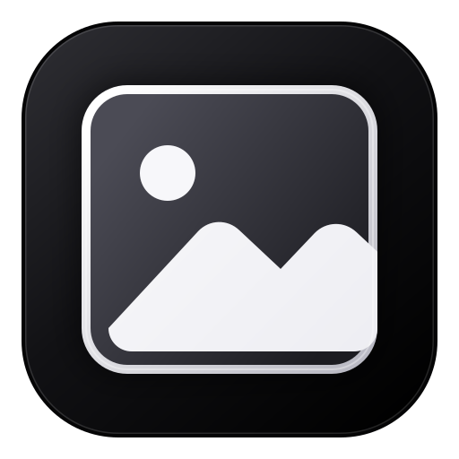

<p align="center">
  
</p>

<h1 align="center">我的相册</h1>

<p align="center">
  一个 iOS 风格暗黑界面的本地相册。照片只在本机读取，不上传、不联网同步。<br>
  Node.js 服务 + 浏览器，不需要 Electron，也没有安装包。
</p>

<p align="center">
  <a href="#源码运行">源码运行</a>
  ·
  <a href="docs/LOADING-2.0.md">流式加载设计</a>
  

<p align="center">
  
  
  
</p>

## 功能

- 选择任意本地文件夹，递归扫描照片和视频
- 按年份、年月显示目录，时间轴从旧到新排列
- **实况照片自动合成一项**：HEIC/JPG + 同名 MOV 合成一个格子，带 LIVE 角标，可悬停/全屏播放
- HEIC / HEIF **先试原图**（装了系统解码器就是真原图、不转换），显示不了才自动转成预览；其它格式自动转缩略图和预览图
- 视频自动截取封面；相册模式下**在应用内播放**（HEVC 优先直出、失败再转），
  切到系统模式则交给 PotPlayer / 系统默认播放器
- 全屏查看照片，滚轮缩放、拖动、左右切换
- 详情面板显示文件名、大小、格式、分辨率、拍摄时间、设备和 GPS
- 高德地图照片地图，位置相同的照片自动聚合
- 日期标题显示当天主要城市
- 显示缓存占用，缓存清理分成三档（缩略图 / 打开的图片视频 / 全部）
- HEVC 视频优先直出（系统能解就不转码），失败自动回退转码
- 大文件夹使用 JSON 索引、增量扫描和分天渐进加载

## 实况照片

iPhone 的实况照片在文件夹里是**两个文件**：一张 `IMG_5832.HEIC`（或 `.JPG`）加一个
同名的 `IMG_5832.MOV`（约 3 秒的视频）。相册会把它们**合成一个项目**显示：

- 照片墙里只有一张卡片，左下角带 `LIVE` 角标；同名 MOV 不再单独占一格
- 鼠标停在那张卡片上 350 ms，会在原地**静音播放**那段实况；移开鼠标就停
- 全屏查看时底部多一个“实况”按钮（快捷键 `L`）：视频叠在静止图上播放，播完自动回到静止图
- 详情面板里会列出伴随视频的文件名、时长和体积

判定规则（和 Lap 一致）：

1. 同一个文件夹里“同名图片 + MOV”是候选（也认 `IMG_5832_HEVC.MOV` 这种加后缀的写法）；
2. 图片头部 XMP 里的 UUID 与 MOV 里的 `com.apple.quicktime.content.identifier` **必须一致**；
   两边都有标识却对不上就**不合并**（宁可显示两个独立项目，也不把不相干的两个文件凑一起）；
3. 两边都没有标识时退回文件名判据（iPhone 的编号一台设备内唯一，照片和视频不会撞号）；
4. 一个 MOV 只能配给一张照片。

实况照片的 MOV 仍然可以单独播放：它会走视频转码管线（HEVC → H.264），第一次播放约 0.7 秒，
之后走缓存。想看看自己的相册里能认出多少对，可以跑体检脚本：

```bash
pnpm audit:live "E:\照片根目录" --verify 30
```

升级说明：索引格式升到 v4。**老索引不用重扫** —— 读进来时会按文件名补一次配对
（只读图片头部和 MOV 尾部各 256 KB，不起 ffmpeg 进程），补完就地写回 v4。


数据保存在项目目录下：

```text
data\
  settings.json          当前照片文件夹
  library-index.json     图库索引
cache\
  thumbnails\            缩略图（照片墙 + 视频封面）
  previews\              预览图（打开图片时生成的大图）
  videos\                视频转码缓存（打开视频 / 实况照片时生成）
  playlists\             PotPlayer 播放列表
```

也可以用环境变量 `MY_ALBUM_DATA_DIR` / `MY_ALBUM_CACHE_DIR` / `MY_ALBUM_DEFAULT_PHOTOS` 把这些目录指到别处。

## 缓存清理

顶部栏的“清理缓存”按钮上显示当前总占用，点开分成三档，各清各的：

| 档 | 删什么 | 影响 |
| --- | --- | --- |
| **缩略图缓存** | `cache\thumbnails\`（照片墙小图、视频封面） | 浏览时重新生成；大相册会重算一轮，会慢一些 |
| **打开的图片 / 视频缓存** | `cache\previews\` + `cache\videos\`（打开过的大图预览、视频转码结果） | 下次打开这些图片/视频时重新生成 |
| **全部缓存** | 整个 `cache\`（还包括播放列表等零碎文件） | 上面两项都发生 |

三档都**不会删除原始照片**，也不会动索引和文件夹设置。举例（一个真实缓存目录）：

```text
缩略图缓存          528 个文件 · 7.5 MB
打开的图片/视频缓存  37 个文件 · 63.5 MB     ← 视频转码占大头
全部缓存            565 个文件 · 71.0 MB
```

只想腾地方又不想重算缩略图时，清中间那一档最合适。

`cache\previews\`（"打开的图片/视频缓存"里的图片部分）**只应该装浏览器真解不了的格式**
（TIFF 等，以及这台机器显示不了、退回转换的 HEIC/HEIF），而且是**你真正打开过那些照片**才会出现。
JPG/PNG 是源文件直出，HEIC/HEIF 在能直出的机器上也是源文件直出 —— 正常浏览不会往里写东西；
要是发现里面躺着一堆 PNG/JPG，那说明有代码路径又在请求预览图了 ——
用这个命令能反查出每个缓存文件对应哪张原图：

```bash
pnpm audit:cache "D:\Pictures"
```

## 打开方式

顶部栏有“相册 / 系统”切换，默认是 **相册**：

- 点击图片：进入应用内全屏浏览，可用左右方向键翻同文件夹照片
- JPG、PNG、WebP、GIF、BMP、AVIF 直接显示原始文件
- **HEIC / HEIF 也先试原图**：这台机器能直接显示（装了「HEIF 图像扩展 + HEVC 视频扩展」）
  就是真原图、不转换、不写缓存；显示不了才转一次
- 全屏预览右下角“原图”：用 Windows 默认照片工具打开原始文件
- **点击视频（相册模式）：也在应用内播放** —— 先试源文件直出（见下一节），这台机器解不了
  才转码；全屏里同样可以用方向键连续翻看
- 切到“系统”：点击图片直接用 Windows 照片工具打开，**点击视频优先用 PotPlayer 打开**
  （并生成同文件夹播放列表；没安装 PotPlayer 时自动使用系统默认播放器）

### 你在查看器里看到的是源文件还是转换图

| 格式 | 查看器显示什么 | 会不会写缓存 |
| --- | --- | --- |
| JPG / JPEG / PNG / WebP / GIF / BMP / AVIF | **源文件本体**（`/api/file/:id`，字节一致，没做任何转换） | 不写 |
| **HEIC / HEIF** | **先给源文件试**（`/api/file/:id`）：这台机器能直接显示就是**真原图**；显示不了自动退回转换预览 | 能直出就**不写**；需要转时才写 `cache\previews\` |
| TIFF 等其它 | 转出来的预览图（最长边 2560px、JPEG 质量 90、4:4:4，按 EXIF 摆正） | **只在真正打开这一张时才转**并写入 `cache\previews\` |
| 视频（H.264 / VP8 / VP9 / AV1） | **源文件本体** | 不写 |
| 视频（HEVC 等浏览器解不了的） | 先试源文件；这台机器解得了就**直出**，解不了才转码 | 直出时**不写**；转码才写 `cache\videos\` |

看图时的几点区别要知道：

- **原生格式就是"原图"**：点开一张 PNG/JPG，浏览器直接读原文件，照片墙翻页也只预加载原文件，
  `cache\previews\` 里不会为它多出任何东西。只有浏览器真的显示失败时（比如扩展名骗人、
  CMYK 或超大图），才退到服务端转一张预览图救场。
- **HEIC/HEIF 现在也是"先试原图"**：Chromium 自己不带 HEIF/HEVC 解码器，但 Windows 上
  装了「**HEIF 图像扩展**」（管 HEIC 容器）+「**HEVC 视频扩展**」（管 H.265 解码）之后，
  `` 能直接显示 HEIC。所以相册先给源文件：成功 → 本会话记住"这台机器能直出"，
  之后所有 HEIC 都直接源文件（**不生成任何缓存，色彩也交给浏览器按原图自带的配置管理，
  比我们转出来的裸 JPEG 准**）；失败 → 自动退回转换预览，只多花一次本地请求。
- **试失败不记"坏结论"**：一张坏图不会让整个会话都放弃试 HEIC（代价只是一次本地请求）。
  想重新从"试"开始：关掉标签页重新打开。
- **转换仍然只在打开时才做**：翻页**不会**顺手把左右邻居也转一遍（那是白花 CPU、白占盘）。
  已经打开过的那些，浏览器按 `immutable` 缓存了转换结果，翻回来照样秒开。
- 详情面板里有一行 **“显示来源”**，直接写明这张是"源文件（未经转换）"还是"转换预览"；
  视频则写“播放方式：源文件直出 / 转码副本（H.264）”。

怎么确认 HEIC 能不能直出：打开一张 HEIC 看详情面板的“显示来源”；或者 F12 → Application →
Session Storage 里有没有 `album-image-source-v1:HEIC = 1`（有 = 这台机器能直出）。

## 直出：图片和视频都先试原图

iPhone 拍的视频基本都是 **HEVC（H.265）**、照片是 **HEIC（容器 + HEVC 编码）**，而 Chromium 系
浏览器自己**不带**这两个解码器 —— 得靠系统解码器（微软商店的「HEVC 视频扩展」+「HEIF 图像扩展」，
或者 OEM 机器预装的）。所以顶栏有一个 **“直出”** 开关（默认开，图片和视频一起管）：

| 情况 | 行为 |
| --- | --- |
| `canPlayType` 明确说能解（`probably`/`maybe`） | 视频**直接播源文件**：不转码、不占 `cache\videos\` |
| **`canPlayType` 答不上来（空串）** | **也先真试一次源文件** —— "答不上来"不等于"解不了"（Chromium 对 `video/quicktime` + `hevc` 这种问法经常答不上来，而它其实能播） |
| 视频试不动（报错，或 5 秒没出画面） | 静默换成转码版本，转圈提示一直盖着（**不露黑屏**、不留两个播放器），并把"这个文件直出失败"记下来，下次直接转码 |
| 视频编码明确不值得试（MPEG-4 / 编码未知） | 不问、不试，直接转码 |
| **HEIC / HEIF 照片** | 也**先给源文件试一次**：这个浏览器能直接显示就是真原图（零转换、零缓存、色彩由浏览器管）；显示不了立刻退回转换预览（多花一次本地请求） |
| **关掉这个开关** | 图片一律转换、视频一律转码（回到"稳"的老行为） |

细节：

- **按钮本身就是"重新试一遍"的入口**：鼠标停在上面会写明当前结论
  （视频 HEVC 是"说能解"还是"答不上来"、HEIC 原图有没有试出来能直出）；
  点一下 = 关掉直出，再点一下 = 打开并**清掉两类记忆**（视频按文件的失败清单 + HEIC 的会话结论）。
  用户中途装了解码器，用这个手势就能立刻生效。
- **预判**用的是 `canPlayType`（Chromium 里它就是去问平台解码器），**按"编码 + 容器"缓存**，
  每个组合每次启动只问一次。结论存在 `sessionStorage`
  （键名 `album-video-probe-v1:编码|容器`，值 `1` = 说能解、`?` = 答不上来），
  在开发者工具的 Application 面板里能直接看到这台机器判成了哪一档。
  **注意：预判现在只决定"提示文案"，不再决定"试不试"** —— 除了明确不值得试的编码，
  一律先真播一次，以实际结果为准。
- **记忆**分两层：会话内按编码记预判结论；跨会话按文件记"直出失败过"（`localStorage`）。
- **隐藏**：直出尝试失败或超时，就在转圈提示后面悄悄换成转码地址，全程不露黑屏、
  也不会留下两个播放器。悬停预览那条路用的是更短的 2.5 秒（悬停是"顺手看一眼"，
  不值得等满 5 秒）。图片那条路失败就换成转换预览，提示写明"这台机器显示不了 HEIC 原图"。
- **实况照片的伴随 MOV 同样走这一套**：鼠标悬停在 LIVE 卡片上、或全屏点"实况"，
  也是"能直出就直出，失败静默换转码"。
- 视频详情里能看到这次到底是“源文件直出”还是“转码副本”。

怎么确认自己的机器有没有 HEVC 解码器（PowerShell）：

```powershell
Get-AppxPackage *HEVC*          # 有输出（HEVC Video Extensions）就说明装了
```

更好的办法是**看相册自己的结论**：打开一台 HEVC 视频，F12 → Application → Session Storage，
找 `album-video-probe-v1:hevc|MOV`（或 `hevc|MP4`）：`1` = 这台机器说能解；`?` = 答不上来
（相册仍然会试一次，试的结果看详情面板的"播放方式"和 `cache\videos\` 有没有新增）。
把 `.MOV` 拖进浏览器标签页那个测试**不能用**来判断 HEVC：`.mov` 的类型是 `video/quicktime`，
Chromium 对它的顶层导航一律改成下载，连 H.264 的 `.mov` 也一样 —— 那是容器的问题，不是编码的问题。

实测（本人相册 `2026\202606` 这一本）：58 个视频里 **56 个是 HEVC**（共 32.1 分钟），
只有 2 个是 H.264。转码一个 9.4 秒的 HEVC 实测要 **1.4 秒**、产出 6.7 MB；
按这个比例，把这一本 32 分钟全转一遍大约要 **十几分钟 CPU + 1 GB 量级的缓存**
（估算，不是逐个数出来的）。装了系统解码器之后这些都可以省掉。

## 性能设计

2.0 的照片墙改成**流式加载**：先拿总数和扫描进度，立刻铺占位格，只渲染可视区附近的块，
按块取数据，缩略图按"离视口中心近"的优先级排队取。所以：

- 冷扫描期间就能看到照片陆续出现，不用等整轮扫描结束
- 扫描期照片按"发现顺序"铺在占位块里（**不做按日期分组**，扫完才分成一天一组 ——
  这是为了不给每轮轮询增加"重算分段 + 重排已铺好的块"的开销）
- 左侧年/月目录在扫描期就出现（边扫边长），扫描期直接点年/月也能过滤
- 实况照片的配对在**目录列表阶段**就定好了（纯文件名运算），所以图片一进格子就带 LIVE 角标、
  伴随 MOV 从头到尾不占格子 —— 不会出现"扫到一半多出一格、扫完又少一格"
- 浏览时只保留当前窗口的数据，内存占用与图库规模解耦
- 取消扫描会保留下已完成的部分，可以继续浏览
- 详细设计见 [docs/LOADING-2.0.md](docs/LOADING-2.0.md)

第一次打开一个新的超大文件夹时，程序仍然要完整读取一次目录和拍摄信息；之后会复用索引：

- 图库索引保存在 `data/library-index.json`
- 重启后直接读取索引，不重新读取 EXIF
- 目录没有新增、删除或改名时，刷新只比对目录签名
- 新增文件时只读取新增或变化的项目
- 视频信息用 FFmpeg 只读文件头，不再整段载入
- HEIC 解码放在 4 个 worker 线程中，不阻塞主界面
- 缩略图为 320px，JPEG 质量 65

索引损坏或需要强制重建时，退出应用，删除 `%APPDATA%\MyAlbum\data\library-index.json`，再打开应用。

“清理缓存”分三档，各自只删自己那一份（缩略图 / 打开的图片视频 / 全部），不会删除原始照片，也不会删除索引和文件夹设置。

## 支持的格式

图片：JPG、JPEG、PNG、HEIC、HEIF、WebP、GIF、AVIF、TIFF、BMP

视频：MP4、MOV、M4V、WebM、AVI、MKV

## 目录识别

推荐按下面的结构存放：

```text
D:\Photos\
  2026\
    202608\
      IMG_0001.HEIC
      IMG_0001.MOV        ← 同名，和上面合成一张实况照片
    202607\
      IMG_0003.JPG
      IMG_0004.MOV        ← 没有同名图片，就是一个普通视频
  2025\
    202512\
      IMG_0005.JPG
```

支持这些写法：

- `2026/202608`
- `2026/08`
- `2026/2026-08`
- `202608`
- 只有年份、没有月份：显示在对应年份下
- 没有年份的散图：显示在“未分类”

选中的根目录本身也可以就是月份文件夹（例如直接选 `...\2026\202606`）：年月会从完整路径里认出来，
侧栏显示“2026 年 → 6 月”。

大相册**扫描还没结束时**侧栏就会出现年/月（用已经读到的那部分边扫边长，张数一路涨到扫描结束），
扫描期直接点年/月也能过滤。

## 安装版（打包好的 exe）

```powershell
pnpm pack                 # 出安装包 + 免安装版（编译、自检、签名一条龙）
pnpm release              # 整理成 release\v<版本>\（传 GitHub Release 用）
pnpm pack:test            # 安装包端到端测试：静默装 → 自检 → 卸载
pnpm pack:verify          # 额外验证：用载荷真解一张 HEIC + 生成一张视频封面
pnpm sign <文件...>        # 单独给 exe 签名（打包时已经自动做了）
pnpm pack:installer       # 可选：装了 Inno Setup 6 时，另外出一版 Inno 安装包
```

产出：

- `成品\`：`我的相册-<版本>-安装包.exe`、`我的相册-<版本>-免安装版\`
- `release\v<版本>\`：**安装包 exe / 免安装版 zip / 源码 zip + SHA256SUMS.txt +
  RELEASE-NOTES.md + PUSH-TO-GITHUB.md** —— 直接拖进 GitHub Release 就能发

**代码签名**：所有 exe（启动器、文件夹选择工具、卸载器、安装包）打包时都会签名。
默认用自动生成的自签证书（`.signing\dev-cert.pfx`，**不会**提交到仓库）；
要消掉别人机器上的 SmartScreen 警告需要一个 CA 签发的证书：

```powershell
$env:MY_ALBUM_SIGN_PFX = "D:\certs\my-album.pfx"
$env:MY_ALBUM_SIGN_PASSWORD = "……"
pnpm pack
```

核验签名：`Get-AuthenticodeSignature .\我的相册-2.0.0-安装包.exe | Format-List Status,SignerCertificate`
（自签证书会显示 `UnknownError` + "not trusted by the trust provider" —— 签名在，但链不受信任，正常。）

安装包怎么用：

- 双击 → 选安装目录（默认 `%USERPROFILE%\AppData\Local\Programs\我的相册`，可以改盘符）
  → 装完可选立刻启动；会创建桌面快捷方式和开始菜单项
- **静默安装**（脚本/批量）：`安装包.exe /silent /dir=D:\我的相册 /noshortcuts /nolaunch`
- **卸载**：安装目录里的 `MyAlbumUninstall.exe`，或"设置 → 应用 → 我的相册"；
  卸载会先关掉正在跑的相册，然后**把 `cache` 和 `data` 一起删掉**（原始照片不动）

安装版的形态：

- **缓存 / 索引 / 设置全在安装目录里**：`<安装目录>\cache`、`<安装目录>\data`
  —— 装到 D 盘，缓存就跟着去 D 盘；卸载时这两处会一起删掉
- 双击快捷方式启动：**没有控制台窗口**，用**你默认的那个浏览器**（Chrome/Edge）的
  `--app=` 开一个没有地址栏的窗口，像桌面应用
- **以管理员身份运行，但不弹 UAC**：安装时会请求**一次**管理员权限，只为登记一个
  "最高权限、无触发器"的计划任务；以后每次启动都由它拉起（管理员身份、静默）。
  免安装版没登记任务时会以普通身份运行；`MyAlbum.exe --uac` 才走会弹窗的老办法，
  `--no-elevate` 强制不提权
- **窗口一定会出现**：无边框窗口 8 秒内没加载出页面 → 自动退回普通浏览器窗口 → 再不行就
  自己弹一个小窗，把地址摆出来（可复制 / 一键用默认浏览器打开 / 打开缓存目录 / 退出）
- **托盘图标**里有"打开相册（无边框窗口） / 用普通浏览器窗口打开 / **手动指定照片文件夹…** /
  打开缓存目录 / 退出"。关掉浏览器窗口**不会**自动退出（退出请点托盘；再点一次快捷方式会把窗口重新打开）
- 出问题先看 `<安装目录>\cache\launcher.log`（启动器日志）和 `cache\server.log`（服务端日志）；
  想跳过无边框窗口可以直接跑 `MyAlbum.exe --plain`
- 目标机器**不用装 Node**（包里自带 `runtime\node.exe`）
- 万一被装到 `C:\Program Files` 这类写不进去的地方：服务端会退到
  `%LOCALAPPDATA%\我的相册` 并把原因写进 `<安装目录>\cache\server.log`（不会静默失败）

## 源码运行

需要 Node.js 20.8 或更高版本，以及 pnpm。

```bash
pnpm install --node-linker=hoisted
pnpm check
pnpm start
```

自动化测试（都在 `test-runtime/` 里生成临时照片，不影响真实图库）：

```bash
pnpm test:geometry   # 窗口/分块几何单测（含"扫描推进时块必须稳定"）
pnpm test:stream     # 服务端流式加载：冷扫描 / 索引秒开 / 扫描中取消
pnpm test:nav        # 侧栏年/月目录：识别 / 扫描期先出现 / 刷新后不丢 / 未分类
pnpm test:live       # 实况照片：合并 / 标识符复核 / _HEVC 变体 / 索引 v4 与 v3 迁移
pnpm test:cache      # 缓存清理三档：只清该清的，缩略图清完还能重新生成
pnpm test:color      # HEIC 色彩：抠出容器里的 ICC → 补进 JPEG → sharp 正确转成 sRGB
pnpm test:paths      # 安装版目录规则：缓存/索引在安装目录；不可写时退到用户目录并告警
pnpm test:dom        # 前端端到端（jsdom + 真实服务 + 真实照片，含 LIVE 角标、悬停预览、缓存弹窗）
pnpm test            # 以上八个依次执行
pnpm bench:scan      # 冷扫描吞吐基准（--images=6000 --runs=3 --client）
pnpm bench:real "E:\照片根目录"   # 真实大相册冷扫描体检
pnpm audit:live "E:\照片根目录"   # 实况照片配对体检（只读，不改文件）
pnpm audit:cache "E:\照片根目录"  # 缓存体检：反查每个缓存文件对应哪张原图
```

`pnpm test:live` 用的是工作区里 `testmedia\` 目录中的**真实素材**
（3 对实况照片 + 静态 HEIC/PNG + 一个独立 MP4），复制（硬链接）到 `test-runtime/live` 下再测。

如果命令行里没有 `node`（`pnpm test` 会报 `'node' is not recognized`），
直接双击 `test.bat`：它用和 `start-web.bat` 一样的方式找 node，再依次跑完这些检查。

前端端到端测试需要 jsdom，只装在 `test-runtime/` 里，不进项目依赖：

```bash
pnpm -C test-runtime add jsdom --node-linker=hoisted
```

### 启动方式

| 方式 | 怎么用 |
| --- | --- |
| 双击启动（推荐） | 双击 `start-web.bat`：自动找 Node、启动服务、打开浏览器 |
| 手动启动 | `pnpm install --node-linker=hoisted`，然后 `pnpm start`，浏览器打开 `http://localhost:3000` |

服务在独立控制台窗口里运行，关掉那个窗口就停止相册。端口默认 3000，想换端口先执行 `set PORT=3100` 再启动。

2.0 **已彻底移除 Electron**：原来的桌面窗口在这台机器上起不来（Chromium 沙箱/受限会话会拦它，原因记录在交接文档里）。去掉桌面外壳后功能不缺 —— 选文件夹走 PowerShell 对话框，打开原图/视频走系统程序，浏览、查看、地图、缓存管理都照常，只是变成一个浏览器标签页而不是桌面窗口。

## 分发

没有安装包。把整个项目目录（含 `node_modules`）拷给对方，装好 Node.js 后双击 `start-web.bat` 即可；
或者只给源码，让对方自己跑一次 `pnpm install --node-linker=hoisted`。

发布流程见 [docs/PUBLISHING.md](docs/PUBLISHING.md)。

## 项目结构

```text
server.js               仅监听 127.0.0.1 的本地 Express 服务（流式接口）
public/photo-stream.js  照片墙流式加载：分块取数、窗口渲染、缩略图调度
public/                 相册界面、预览器、地图
lib/media.js            流式扫描会话、EXIF、视频探测、缩略图、索引
lib/app-paths.js        数据、缓存、默认照片目录
lib/settings.js         保存当前照片文件夹
lib/folder-picker.js    PowerShell 文件夹选择窗口
lib/heic-pool.js        HEIC 后台转换线程池
lib/heic-color.js       从 HEIC 里抠 ICC 色彩配置，补进转换出来的 JPEG（修色差）
lib/launcher.js         系统照片、PotPlayer 或系统播放器打开原文件
lib/city-lookup.js      根据 GPS 匹配最近城市
assets/icon.png         页面图标（favicon）
tools/                  语法检查 + 五套自动化测试 + 体检/基准脚本
docs/LOADING-2.0.md     流式加载与实况照片配对说明
docs/PUBLISHING.md      发布步骤
```

服务只监听 `127.0.0.1`，不对外开放端口。浏览器页面通过本机回环地址访问接口，
照片读取、缩略图生成、打开原文件都由 Node 服务完成，浏览器本身拿不到文件系统权限。

## 隐私

- 照片、视频、EXIF 和索引完全在本机读取
- 不包含账号、统计、遥测或云同步
- 只有高德地图瓦片需要联网加载
- 清理缓存不会删除原始照片

## 常见问题

**提示照片文件夹不存在**

原文件夹可能被移动、重命名，或磁盘没有连接。点击“选择照片文件夹”重新选择即可。索引和缓存不会因此丢失。

**首次打开很慢**

第一次读取超大文件夹需要完整扫描一次。以后启动会使用 JSON 索引。

**视频没有用 PotPlayer 打开**

先看顶栏是不是在“相册”这一档：**相册模式点视频是在应用内播的**（这才是默认行为），
要用 PotPlayer 得切到“系统”。切到系统还是不弹，说明程序没找到 PotPlayer：
它会自动查找常见安装位置，也可以设置环境变量 `POTPLAYER_PATH` 指向 `PotPlayerMini64.exe`，
两者都没有时交给系统默认播放器。
（全屏查看器右下角的“原图”按钮不受这个开关影响，任何时候都是交给系统 / PotPlayer 打开。）

**照片墙上的格子突然变大、一行变少了**

窗口宽度变过（改窗口大小、最大化、浏览器缩放、侧栏出现/消失）之后列数就该重算。
以前已经铺好的那些块不会重新套列数，所以格子会停在旧列数上一直放大着；
现在列数一变就写回旧网格（仍然是原地改，不会整块重建、不会闪）。
如果还看到某一行数目不对，按 F5 刷一次并告诉我当时的窗口宽度。

**实况照片只显示了一张，MOV 去哪了**

这是**故意的**：同名的“图片 + MOV”被识别成一对实况照片，合并成一个项目，MOV 不再单独显示。
想确认配对了多少对、判定依据是什么，跑：

```bash
pnpm audit:live "你的照片根目录" --verify 30
```

它只读文件、不改任何东西。如果确实有一对（比如导出时丢了标识符）没被合并，报告里会写出来。

**鼠标停在实况照片上等了半秒才动**

第一次播放要把 HEVC 的 MOV 转成浏览器能播的 H.264（约 0.7 秒），转完会缓存，之后就很快。
鼠标一移开预览就停，不会一直占着解码器。

**想清理缓存但不想重新生成缩略图**

点“清理缓存”，选中间那一档“打开的图片 / 视频缓存”：只删你打开过的大图预览和视频转码结果，
照片墙上的小图留着（视频转码通常才是占地方的大头）。

**清理缓存会不会把照片删掉**

不会。三档都只动 `cache\` 下的生成物，原始照片、索引和文件夹设置都不碰。

**视频点开后要等好几秒（一直显示"正在准备视频"）**

说明这台机器的浏览器解不了这个编码，正在转码（HEVC → H.264）。**装一个系统 HEVC 解码器就不用转了**：
微软商店搜「HEVC 视频扩展」装上，然后**关掉标签页重新打开相册**（预判结论存在 sessionStorage 里，
按 F5 刷新是不会重新问的），之后相册会直接播源文件（顶栏“直出”开关保持打开状态）。
已经转码过的视频不受影响，仍旧秒开。

**视频打开时先闪一句"正在试播源文件"再跳到转码**

这是"预判答不上来"的正常流程：浏览器不肯明确回答能不能解 HEVC（`canPlayType` 回空串），
相册就**真播一次**试试，试不动（报错或 5 秒没画面）才换转码版本。第一次这样，
之后这个文件被记住了、直接转码，不会每次试。想让它重新试：把“直出”关掉再打开。

**HEIC 照片打开时会闪一下才显示出来**

那是"先试原图"的正常流程：相册先把**源文件**给浏览器，这台机器显示不了就立刻退回去转一次。
想让它稳定直出：设置 → 应用里确认 **「HEIF 图像扩展」和「HEVC 视频扩展」都装了**
（照片是 HEIC 容器 + HEVC 编码，两个包各管一头），然后**关掉标签页重新打开**相册。
能直出之后 `cache\previews\` 里不会再为 HEIC 生成东西 —— 详情面板的“显示来源”会写
"源文件（未经转换）"。

**HEIC 的颜色和 Windows 照片不一样（偏艳或发灰）**

**已经修好了**（2026-10-25）：以前转换链写出来的是**没有色彩标签的 JPEG**，iPhone 的
Display P3 被当成 sRGB 显示，所以偏色。现在会把 HEIC 里自带的 ICC 色彩配置抠出来、
补到中间产物上，sharp 再按它**正确转成 sRGB**，颜色就和 Windows 照片一致了。
已经生成过的旧预览/缩略图不会自己变：预览换过缓存版本号（旧的直接不再被使用），
缩略图会在下次启动时**自动删掉重新生成**（第一次浏览会看到缩略图重新长出来，稍慢）。
想立刻清干净：点“清理缓存”里的“打开的图片 / 视频缓存”。
另外 HDR（带增益图）的 HEIC 在浏览器里只显示 SDR 那一层，这一点两边无论如何都会有差别。

**HEIC 直出（浏览器直接显示原图）为什么不行**

Chromium 系浏览器（Chrome/Edge）在 Windows 上**没有内置 HEIC 解码器**，实测即使装了
「HEIF 图像扩展 + HEVC 视频扩展」，`` 也显示不出来。所以相册的策略是"**先试一次源文件**"：
能显示就是真原图（零转换、零缓存），显示不了立刻退回转换预览（多花一次本地请求）。
详情面板的“显示来源”会告诉你实际显示的是哪一种。

**地图是空白**

地图瓦片需要联网。照片和索引本身完全在本地读取。

**双击 start-web.bat 后浏览器没打开**

可能是端口被占用。先关掉其它相册窗口，或先执行 `set PORT=3100` 再启动，然后手动打开 `http://localhost:3100`。

**浏览器提示无法访问此页面**

说明服务窗口（标题 `My Album Server`）已经关掉了。重新双击 `start-web.bat` 即可。

**想让它跟着电脑开机自动启动**

把 `start-web.bat` 的快捷方式放进“启动”文件夹（`shell:startup`）即可，不需要装任何服务。

## License

[MIT](LICENSE)
